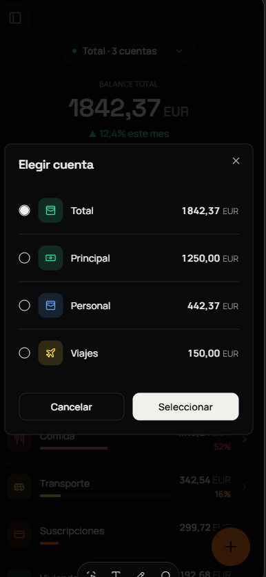

# Cushqui App

## Role

Programador Frontend y Diseñador grafico senior experto en Next.js y Tailwind css

## Contexto

Quiero crear desde cero "Cushqui" una aplicacion que sera web o mobile, donde pueda gestionar mis gastos diarios, clasificarlos, añadir, editar o eliminar gastos. Crear diferentes cuentas entre otras funciones (especificado en el apartado Especificaciones).

## Pantallas y funciones

### Login y Registro

 -> Login y Registro

Solo debe pedir campos de email y contraseña.
Para el registro basate en la imagen de login y aumenta campo de confirmar contraseña

### Pantalla Inicial

 -> Pagina Inicial

- En la parte superior y centrado mostrar un dropdown de las cuentas (Total por default)
- Debajo y en el centro mostrar el balance de la cuenta seleccionada
- Tener dos Tabs para GASTOS | INGRESOS
- Tener un icono para avanzar a la pantalla transacciones
- Ver en un diagrama de pastel con el porcentaje de gasto por categoria en el medio del diagrama debe estar el todal ya sea de gastos o ingresos
- Al hacer click en una categoria poder avanzar hacia las subcategorias y ver nuevamente un diagrama de pastel como el de categorias
- Ver debajo del diagrama de pastel una lista con el icono y color de cada categoria y ver el total de ese gasto -> Ex WTF (Rosa) 52% 15,85 EUR. El gráfico debe compactarse automáticamente al primer desplazamiento hacia abajo en móvil; solo la lista se desplaza. Y volverse a descompactar cuando el dropdown de la lista de gastos este al principio.

 -> Compactado circulo de barras

`Click en drowpdown`
 -> modal para elegir cuenta

Al clicar en la dropdow muestre un modal para elegir las diferentes cuentas
Este modal debe mostrar una lista de radio bottons de todas las cuentas (nombre de la cuenta, icono o color, balance)
Debe tener un boton para cancelar la accion y otro para seleccionar

`Barra Lateral`
 -> Barra lateral mostrada

Añadir un menu como barra lateral cue se pueda mostrar o esconder, Para que cada pantalla pueda ocupar totalmente el espacio, opciones son las siguientes:

- Inicio
- Transacciones
- Cuentas
- Categorias

### Transacciones

 -> Transacciones

- Tener 3 tabs uno para GASTOS | INGRESOS | CLASIFICAR
  GASTOS e INGRESOS
- Mostrar por fecha las transacciones que se hicieron junto con su categoria o subcategoria, cantidad, cuenta a la que pertenece, icono, color y descripcion (esto solo para GASTOS | INGRESOS )

`CLASIFICAR`

 -> Clasificar

- Listas todas las transacciones que esten por clasificar mostrando la cuenta origen, descripcion, total, ademas de mostrar un boton de dividir cuenta dentro del detalle de editar transaccion

`Detalle transaccion`
 -> Detalle

- Mostrar icono de editar
- Mostrar cantidad, cuenta, categoria, subcategoria, fecha, descripcion
- Si es clasificar mostrar directamente en modo editar

`Editar transaccion`

 -> Editar Transaccion

- Mostrar dos tabs GASTOS | INGRESOS
- Mostrar monto en el medio junto con el currency
- Mostrar cuenta
- Mostrar categorias
- Mostrar subcategorias junto con las categorias
- Campo para ingresar descripcion
- Mostrar boton para dividir cuenta
- Cuenta tambien debe tener el color e icono en el dropdow.

`Dividir cuenta`
 -> Dividir cuenta
 -> Dividir cuenta despues de dar click "Generar calculo"
Opcion para dividir cuenta el cual abra un modal y pida un numero de personas. ( tipo - 2 + ) cuando se clicke en + aumente el numero y tambien poder editar el boton, debajo un boton generar calculo.

Muestre una lista de movimientos por generar. Ejemplo:

Monto 38,89 - division para 6. Resultado de la division (6,4816666667 )-> redondear siempre para arriba en este caso -> 6.5, si en otro caso hubiera sido (9,98 -> 10 ) o (9,456 -> 9,46 ) Lista despues del boton calcular:

Movimiento 1 6.5 (en color amarillo)
Movimiento 2 6.5 (en color amarillo)
Movimiento 3 6.5 (en color amarillo)
Movimiento 4 6.5 (en color amarillo)
Movimiento 5 6.5 (en color amarillo)
Movimiento 6 6.39 (en color verde) -> valor restande de 38,89 - (6,5 x 5)
Debajo de la lista dos botones: Cancelar - Confirmar.

Debe ser posible editar los numeros y se debe calcular el el ultimo movimiento en funcion de los cambios que se haga en esos campos
Despues de confirmar
Mostrar notificacion de cuantos movimientos se crearon (en este caso 5 movimientos)
Y que el actual se quede con el nuevo valor y proseguir a actualizarlo
Mostrar en algun lado una etiqueta de que fue fraccionado.

### Cuentas

 -> Cuentas

Muestra balance total con su moneda en el centro:
Debajo dos botones: Historial Transferencias - Nueva Transferencia
Debajo Lista de las cuentas con su icono, color y balance. (al clickar en un item ir Editar/Añadir cuentas)

`Añadir cuentas - Editar/Añadir cuentas `

Campos para el nombre de la cuenta, lista de iconos y una lista de colores para el icono.

### Categorias

Mostrar dos tabs GASTOS | INGRESOS en el centro

Debajo mostrar todas las categorias con su color e icono en un grid sin lineas (Al dar click en la categoria se ira a la pantalla de editar) por gastos e ingresos

` Añadir categorias`
 

Añadir/Editar categorias:

Icono de la categoria junto al nombre

Debajo lista de iconos disponibles

Debajo colores disponibles:

`Boton para añadir subcategoria`

Lista de subcategorias cada item debe tener el mismo icono del icono de la categoria con el mismo color pero en degradao y dos botones para editar, eliminar.
Al editar y añadir solo se pide el nombre.
Transacciones Al editar una transaccion

## Backend

Tienes la documentacion relacionada a la API que realizara estas operacioens en el siguiente link.

http://localhost:3000/docs#/

Ademas de un pequeño resumen aqui:

### Authentication

| Method | Endpoint                | Description          |
| ------ | ----------------------- | -------------------- |
| POST   | `/api/v1/auth/register` | Register new user    |
| POST   | `/api/v1/auth/login`    | Login user           |
| POST   | `/api/v1/auth/refresh`  | Refresh access token |
| POST   | `/api/v1/auth/logout`   | Logout user          |
| GET    | `/api/v1/auth/me`       | Get current user     |

### Accounts

| Method | Endpoint                       | Description         |
| ------ | ------------------------------ | ------------------- |
| GET    | `/api/v1/accounts`             | List all accounts   |
| POST   | `/api/v1/accounts`             | Create account      |
| GET    | `/api/v1/accounts/:id`         | Get account by ID   |
| PATCH  | `/api/v1/accounts/:id`         | Update account      |
| DELETE | `/api/v1/accounts/:id`         | Delete account      |
| GET    | `/api/v1/accounts/:id/balance` | Get account balance |

### Categories

| Method | Endpoint                 | Description                     |
| ------ | ------------------------ | ------------------------------- |
| GET    | `/api/v1/categories`     | List categories (global + user) |
| POST   | `/api/v1/categories`     | Create category                 |
| GET    | `/api/v1/categories/:id` | Get category by ID              |
| PATCH  | `/api/v1/categories/:id` | Update category                 |
| DELETE | `/api/v1/categories/:id` | Delete category                 |

### Transactions

| Method | Endpoint                            | Description                      |
| ------ | ----------------------------------- | -------------------------------- |
| GET    | `/api/v1/transactions`              | List transactions (with filters) |
| POST   | `/api/v1/transactions`              | Create transaction               |
| GET    | `/api/v1/transactions/:id`          | Get transaction by ID            |
| PATCH  | `/api/v1/transactions/:id`          | Update transaction               |
| DELETE | `/api/v1/transactions/:id`          | Delete transaction               |
| POST   | `/api/v1/transactions/:id/classify` | Classify transaction             |

**Transaction Filters:**

- `accountId` - Filter by account
- `categoryId` - Filter by category
- `status` - `UNCLASSIFIED` or `CLASSIFIED`
- `type` - `EXPENSE`, `INCOME`, `TRANSFER`
- `source` - `MANUAL`, `APPLE_PAY`, `MBWAY`, `REVOLUT`, `BANK`, `OTHER`
- `from` - Start date (ISO 8601)
- `to` - End date (ISO 8601)
- `page` - Page number (default: 1)
- `limit` - Items per page (default: 20, max: 100)

**Query params:** `from`, `to` (ISO 8601 dates)

### Transfers

| Method | Endpoint            | Description                      |
| ------ | ------------------- | -------------------------------- |
| POST   | `/api/v1/transfers` | Create transfer between accounts |

## Tarea

Quiero que crees esta aplicacion teniendo en cuenta que va a ser para web y dispositivos mobiles (especial uso en moviles)

El diseño debe ser simple pero atractivo, con interfas responsive y una paleta de colores minimalista, en darkmode.

Debes guiarte en las imagenes que te anexe para crear las interfaces.

Quiero que ademas puedas conectar el backend que se encuentra corriendo localmente en http://localhost:3000/api/v1

Crea una primera version mostrando las funcionalidades que te mostre, especialmente cuentas, categorias, pantalla de incio y transacciones y dividir cuenta.
